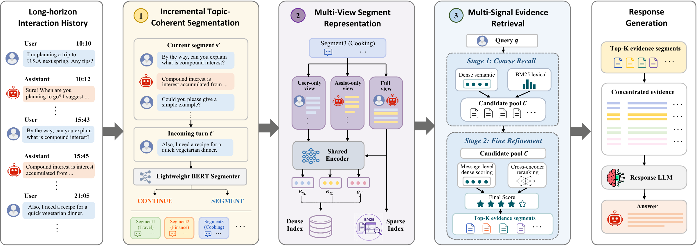

# Threader

Official implementation of **Beyond Memory Construction: Rethinking Memory Access for LLM-based Conversational Agents**.

[](https://arxiv.org/abs/2609.33226)

**LLM-based memory construction becomes increasingly lossy, unstable, and costly as conversations grow longer and more complex.** Threader preserves raw interactions and organizes them into coherent topical segments through lightweight segmentation. It combines multi-view representations with segment-level retrieval and local evidence matching to **improve answer accuracy with low latency and reduced memory construction overhead.**



> [!NOTE]
> Index building, retrieval, response generation, and answer evaluation are available for LongMemEval and PersonaMem, with support for adapting additional datasets through [configurable field mappings](#adapting-other-datasets). **The segmenter will be released soon.** The current pipeline expects conversations that have already been segmented.

## Contents

- [Threader](#threader)
  - [Contents](#contents)
  - [Installation](#installation)
  - [Data preparation](#data-preparation)
    - [Files and directories](#files-and-directories)
    - [Default input fields](#default-input-fields)
  - [Running the pipeline](#running-the-pipeline)
    - [LongMemEval](#longmemeval)
    - [PersonaMem](#personamem)
    - [Configuration and sample selection](#configuration-and-sample-selection)
  - [Adapting other datasets](#adapting-other-datasets)
  - [License](#license)
  - [Citation](#citation)

## Installation

Run the following from your Python environment:

```bash
git clone https://github.com/Donghua-Cai/Threader.git
cd Threader
python -m pip install -r requirements.txt
```

The default retrieval models in [config/baseline.yaml](config/baseline.yaml) are:

| Component | Model |
|---|---|
| Embedding | `sentence-transformers/paraphrase-multilingual-MiniLM-L12-v2` |
| Reranker | `BAAI/bge-reranker-base` |

These models run locally through `sentence-transformers`. The embedding and reranker backends also support HTTP APIs; configure `backend`, `api_url`, and `api_token_env` in the same YAML file when using hosted models.

For response generation and LLM judging, set an API key:

```bash
export OPENAI_API_KEY="your-api-key"
```

The examples below use [config/runtime_api.example.yaml](config/runtime_api.example.yaml), which reads the key from the environment. Separate response and judge credentials can be supplied through `RESPONSE_API_KEY` and `JUDGE_API_KEY`; their endpoint overrides are `RESPONSE_BASE_URL` and `JUDGE_BASE_URL`.

For a custom runtime configuration, copy the example to a local file and pass its path with `--runtime-config` to `scripts/response.py`. Keep actual credentials out of the public repository.

## Data preparation

### Files and directories

Prepare one JSON file per sample. Questions and segmented conversations can be stored in separate directories, passed as `--question-dir` and `--segment-dir`. **Both arguments can also point to the same directory** when each sample JSON contains both the segmented conversation and its QA fields.

Both flat directories and directories grouped by question type are supported. For example:

```text
data/
  longmemeval/
    segments/
      00001.json
      00002.json
    questions/
      00001_original-question-id.json
      00002_original-question-id.json
  personamem/
    segments/
      recall_user_shared_facts/
        00001.json
      suggest_new_ideas/
        00003.json
    questions/
      recall_user_shared_facts/
        00001_original-question-id.json
      suggest_new_ideas/
        00003_original-question-id.json
```

Samples are matched by the filename prefix before the first underscore: both `00001.json` and `00001_original-question-id.json` map to sample ID `00001`. Use unique sample IDs across question types. Each input directory can use either layout independently; directory names do not need to end in `_by_question_type`.

If QA fields are stored in the segment files themselves, `--question-dir` can be omitted. During response generation, exported query fields take priority over source QA metadata.

### Default input fields

A minimal segment file looks like this:

```json
{
  "conversation_id": "00001",
  "segments_messages": [
    [
      {"role": "user", "content": "I prefer tea.", "time": "2026-01-01T09:00:00", "order": 0},
      {"role": "assistant", "content": "Noted.", "time": "2026-01-01T09:00:01", "order": 1}
    ]
  ]
}
```

`segments_messages` is a list of segments, where each segment is a list of message objects. Messages use `role` and `content`; optional `time` and `order` fields control chronological ordering. `conversation_id` defaults to the filename's sample ID when absent. Optional `session_ids` and `session_num_segments` describe which session each segment belongs to.

A corresponding question file can contain:

```json
{
  "question_id": "q1",
  "dataset": "longmemeval",
  "question_type": "single-session-user",
  "question": "What drink do I prefer?",
  "question_date": "2026-01-02T10:00:00",
  "answer": "Tea"
}
```

| QA field | Purpose |
|---|---|
| `question` | Question used for retrieval and answering. |
| `question_id`, `dataset` | Optional source identifiers carried into outputs. |
| `question_type` | Category used for filtering and per-type answer statistics. |
| `question_date` | Optional date added to the response prompt for temporal reasoning. |
| `answer` | Reference answer for evaluation. |
| `answer_options` | Multiple-choice options, as a list. |
| `correct_answer_label` | Correct option label for multiple-choice evaluation. |

PersonaMem options and labels can also be read from `meta.multiple_choice.all_options` and `meta.multiple_choice.correct_answer_label` (or the corresponding `qa.meta` structure).

For different input field names, use the [dataset field mapping](#adapting-other-datasets) below. Field mapping does not perform segmentation; prepare segmented inputs until the segmenter is released.

## Running the pipeline

All commands below run from the repository root. Replace the data paths with your own directories.

| Stage | Script | Result |
|---|---|---|
| Build | `scripts/build_index.py` | One SQLite index per sample with segment embeddings, BM25, and pair-turn embeddings. |
| Query | `scripts/query.py` | Retrieval report and per-sample query JSON files. |
| Response | `scripts/response.py` | Answers, evaluation results, and the retrieved history used by the model. |

### LongMemEval

Build indexes:

```bash
python scripts/build_index.py \
  --config config/baseline.yaml \
  --segment-dir ./data/longmemeval/segments \
  --question-dir ./data/longmemeval/questions \
  --index-dir ./artifacts/longmemeval/indexes \
  --question-type ALL \
  --workers 1
```

Retrieve relevant segments:

```bash
python scripts/query.py \
  --config config/baseline.yaml \
  --segment-dir ./data/longmemeval/segments \
  --question-dir ./data/longmemeval/questions \
  --index-dir ./artifacts/longmemeval/indexes \
  --question-type ALL \
  --final-topk 12 \
  --ranked-source hybrid \
  --workers 1 \
  --output-json ./artifacts/longmemeval/query_report.json \
  --query-output-dir ./artifacts/longmemeval/queries
```

Generate answers and evaluate them with an LLM judge:

```bash
python scripts/response.py \
  --config config/baseline.yaml \
  --query-dir ./artifacts/longmemeval/queries \
  --segment-dir ./data/longmemeval/segments \
  --question-dir ./data/longmemeval/questions \
  --response-model gpt-5-mini \
  --judge-model gpt-4.1-mini \
  --judge-mode llm \
  --runtime-config config/runtime_api.example.yaml \
  --response-prompt-file config/response_prompt.txt \
  --judge-prompt-file config/judge_prompt.txt \
  --workers 2 \
  --out-dir ./artifacts/longmemeval/responses \
  --output-json ./artifacts/longmemeval/responses.json
```

### PersonaMem

Build indexes:

```bash
python scripts/build_index.py \
  --config config/baseline.yaml \
  --segment-dir ./data/personamem/segments \
  --question-dir ./data/personamem/questions \
  --index-dir ./artifacts/personamem/indexes \
  --question-type ALL \
  --workers 1
```

Retrieve relevant segments:

```bash
python scripts/query.py \
  --config config/baseline.yaml \
  --segment-dir ./data/personamem/segments \
  --question-dir ./data/personamem/questions \
  --index-dir ./artifacts/personamem/indexes \
  --question-type ALL \
  --final-topk 8 \
  --ranked-source hybrid \
  --workers 1 \
  --output-json ./artifacts/personamem/query_report.json \
  --query-output-dir ./artifacts/personamem/queries
```

Generate multiple-choice answers and compare the predicted A–D option against the reference label:

```bash
python scripts/response.py \
  --config config/baseline.yaml \
  --query-dir ./artifacts/personamem/queries \
  --segment-dir ./data/personamem/segments \
  --question-dir ./data/personamem/questions \
  --response-model gpt-5-mini \
  --judge-mode code_mcq \
  --runtime-config config/runtime_api.example.yaml \
  --response-prompt-file config/response_prompt_personamem.txt \
  --workers 2 \
  --out-dir ./artifacts/personamem/responses \
  --output-json ./artifacts/personamem/responses.json
```

`code_mcq` uses code to score the selected option; it does not call an LLM judge. Use `--judge-mode none` to generate answers without evaluation.

### Configuration and sample selection

The examples explicitly select **Top-12 for LongMemEval** and **Top-8 for PersonaMem**. The code does not choose Top-K based on the dataset name: `--final-topk` overrides `router.final_topk` in the config, whose default is `12`.

| Argument | Applies to | Purpose |
|---|---|---|
| `--config` | All stages | Retrieval settings and dataset field mappings. Use the same config across stages. |
| `--question-type` | All stages | Process a category or `ALL`. |
| `--sample-id` | All stages | Process a specific sample. |
| `--sample-limit`, `--sample-offset` | All stages | Select a slice of the discovered samples. |
| `--sample-ids-file` | Query | Read selected sample IDs from a text file, one per line. Build their indexes first. |
| `--workers` | All stages | Number of workers; adjust to local resources and API capacity. |
| `--overwrite` | Build | Rebuild an existing index after changing data, embeddings, or field mappings. |
| `--final-topk` | Query | Number of retrieved segments exported for answering. |
| `--ranked-source` | Query | Select `hybrid`, `base`, or `rerank` output. |
| `--exclude-abstention` | Query | Set to `1` to filter samples identified by abstention directories or QA filename markers. Defaults to `0`. |

For a small run, add the same `--sample-id 00001` to the three stages. For category-level runs, use a category such as `multi-session` or `recall_user_shared_facts`. When filtering flat segment files without question-type metadata, supply `--question-dir` so the category can be read from the matching question file.

The default retrieval path uses the original question directly. Retrieval rankings are preserved in query outputs; response history is ordered by segment time, message order, and segment ID.

## Adapting other datasets

Configure `dataset.field_mapping` to read different field names and nested JSON structures. **Mapping keys are Threader's standard names; mapping values are paths in your data.** Unspecified fields keep the defaults, and exported results always use the standard names.

Copy [config/baseline.yaml](config/baseline.yaml) to `config/my_dataset.yaml` and edit its `dataset` section, retaining the model and retrieval settings.

If your segment-list field is named `segments`, only this mapping is needed:

```yaml
dataset:
  field_mapping:
    segment:
      segments_messages: segments
```

For nested data, a segment file might contain:

```json
{
  "memory": {
    "id": "conversation-1",
    "chunks": [
      {
        "messages": [
          {"speaker": "human", "text": "I prefer tea.", "timestamp": "2026-01-01", "position": 0},
          {"speaker": "bot", "text": "Noted.", "timestamp": "2026-01-01", "position": 1}
        ]
      }
    ]
  }
}
```

Its question file might use:

```json
{
  "qa": {
    "id": "q1",
    "text": "What drink do I prefer?",
    "category": "fact-recall",
    "answer": "tea"
  }
}
```

For this nested layout, configure the `dataset` section as follows:

```yaml
dataset:
  exclude_abstention: false
  field_mapping:
    segment:
      segments_messages: memory.chunks
      conversation_id: memory.id
      messages: messages
    message:
      role: speaker
      content: text
      time: timestamp
      order: position
    question:
      question_id: qa.id
      question: qa.text
      question_type: qa.category
      answer: qa.answer
  role_mapping:
    human: user
    bot: assistant
```

Pass **`--config config/my_dataset.yaml` to build, query, and response**, and set their input/output directories for the new dataset. Dot-separated paths such as `memory.chunks` traverse nested JSON objects. `role_mapping` converts role values, matching without case or surrounding whitespace.

| Mapping section | Supported standard names | Source paths are relative to |
|---|---|---|
| `segment` | `segments_messages`, `conversation_id`, `session_ids`, `session_num_segments` | The sample object. |
| `segment` | `messages` | Each segment object. Omit this entry when segments are already message lists. |
| `message` | `role`, `content`, `time`, `order` | Each message object. |
| `question` | `question`, `question_id`, `question_type`, `question_date`, `answer`, `answer_options`, `correct_answer_label`, `dataset` | The question file, or the segment file when QA is stored there. |

Field mapping supports renamed fields and nested objects while retaining the one-sample-per-file layout and filename-based matching. Conversation data must still resolve to a list of segments containing message objects. Missing segment fields or malformed segment/message structures raise an error. After changing mappings, rebuild indexes with `--overwrite` and rerun retrieval before generating responses.

## License

This project is licensed under the [Apache License 2.0](LICENSE).

## Citation

If you find our work helpful for your research, please consider citing our paper:

```bibtex
@misc{cai2026memoryconstructionrethinkingmemory,
      title={Beyond Memory Construction: Rethinking Memory Access for LLM-based Conversational Agents},
      author={Donghua Cai and Yongheng Deng and Yifei Wang and Zijun Shen and Ju Ren},
      year={2026},
      eprint={2609.33226},
      archivePrefix={arXiv},
      primaryClass={cs.CL},
      url={https://arxiv.org/abs/2609.33226},
}
```
